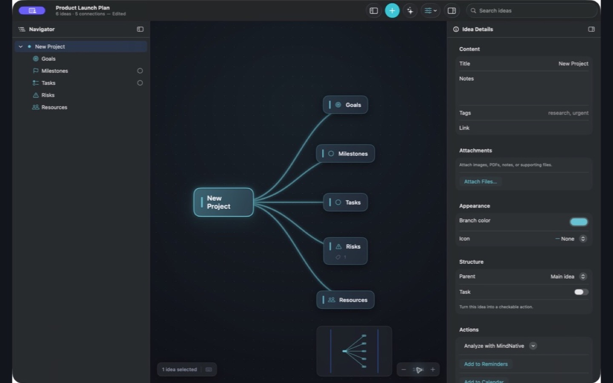

# MindNative

MindNative is an open-source mind map app for macOS.
The app has no license fee.
See the [website](https://sirwan.info/mindnative/) for app views and build steps.
Use it to connect ideas, add notes, and save maps as `.mindnative` files.

The app keeps maps on your Mac.
You can also save maps in iCloud Drive.
Apple Intelligence can make ideas on compatible Macs.



## Functions

- Make ideas and child ideas.
- Connect ideas with branches and cross-links.
- Add notes, tags, links, tasks, images, and attachments.
- Search map content with the Navigator.
- Put ideas in horizontal, vertical, radial, or compact layouts.
- Show one idea at a time in presentation mode.
- Import Markdown, OPML, FreeMind, and XMind files.
- Export Markdown, OPML, FreeMind, XMind, PNG, PDF, and SVG files.
- Send selected ideas to Calendar or Reminders.
- Use Shortcuts to make maps and export outlines.
- Restore local recovery copies and resolve file conflicts.

The app has English and Spanish controls.
See the [presentation](docs/images/presentation.jpg) and [radial layout](docs/images/radial.jpg) screenshots.

## Requirements

- The app targets macOS 13.0 or later.
- The source code requires Xcode 26 or later.
- Apple Intelligence requires macOS 26 or later and a compatible Mac.
- To use Apple Intelligence, set it to ON in System Settings.

If Apple Intelligence cannot run, the app makes ideas from a built-in list.
See the [Apple Intelligence screenshot](docs/images/apple-ai.png).

## Build the app

Build the app from source.
This repository does not yet have a packaged app release.

1. Clone the repository:

   ```sh
   git clone https://github.com/SirwanAfifi/mindnative.git
   ```

2. Open the project:

   ```sh
   open mindnative/MindNative.xcodeproj
   ```

3. Select the `MindNative` scheme in Xcode.
4. Select **My Mac** as the destination.
5. Select **Product > Run**.

See [Build and test](docs/BUILD.md) for command-line instructions.

## Use the app

1. Make a document.
2. Select **New idea** to add the first idea.
3. Add child ideas with the **+** button.
4. Select an idea to change its content in the Inspector.
5. Use **File > Save** to save the map.

Use the File menu to import or export a map.
Use the Canvas menu to change the layout or start a presentation.

## Privacy

MindNative does not send map content to a MindNative server.
Link previews contact the linked website.
Update checks contact GitHub.
See the [privacy policy](PRIVACY.md) for data storage and deletion information.

## Support

Use [GitHub Issues](https://github.com/SirwanAfifi/mindnative/issues) to give a problem report or suggest a change.
See [CONTRIBUTING.md](CONTRIBUTING.md) before you submit code.
See [RELEASE_NOTES.md](RELEASE_NOTES.md) for version information.

## License

MindNative uses the [MIT license](LICENSE).
You can use, change, and share the app and its source code.
Include the license notice when you share a copy.
See [THIRD_PARTY_NOTICES.md](THIRD_PARTY_NOTICES.md) for dependency license terms.
